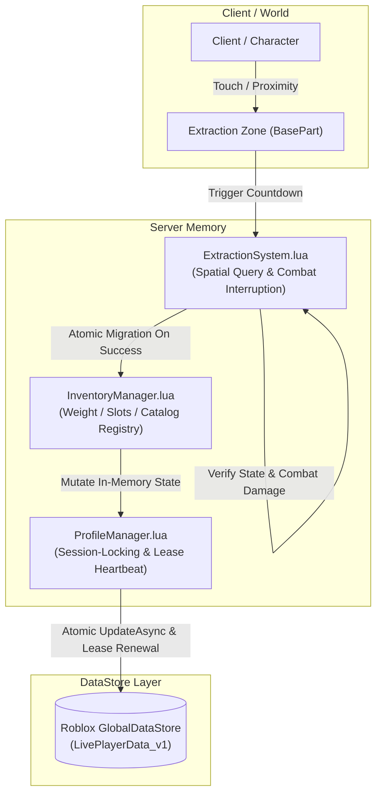
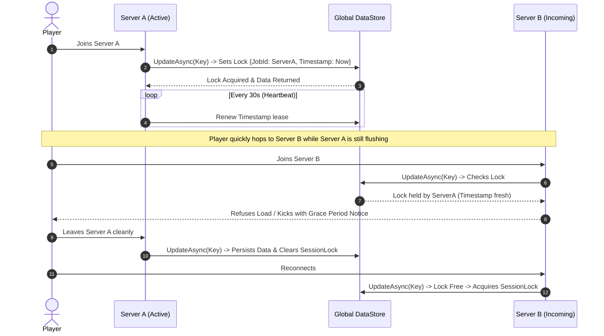
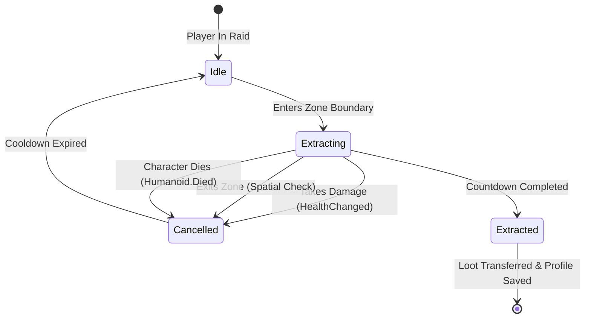

# Enterprise Roblox Architecture: Secure Inventory, Tactical Extraction & Session-Locked Persistence

[](https://luau-lang.org/)
[](https://developer.roblox.com/en-us/api-reference/class/DataStoreService)
[]()
[](https://rojo.space/)

> **Production-grade gameplay backend for Roblox.** Designed for high-stakes games (Extraction Shooters, Hardcore Survival, ARPGs) requiring bank-grade item persistence, strict server validation, and race-condition immunity.

---

## Table of Contents / Tabla de Contenidos

1. [English Documentation](#english-documentation)
   - [Architectural Overview](#architectural-overview)
   - [Anti-Duping: Session-Locking Deep Dive](#anti-duping-session-locking-deep-dive)
   - [Server-Authoritative Inventory Validation](#server-authoritative-inventory-validation)
   - [Tactical Extraction State Machine](#tactical-extraction-state-machine)
   - [Integration Guide (ServerScriptService & Rojo)](#integration-guide-serverscriptservice--rojo)
2. [Documentación en Español](#documentación-en-español)
   - [Resumen de la Arquitectura](#resumen-de-la-arquitectura)
   - [Mecanismo Anti-Duping: Session-Locking](#mecanismo-anti-duping-session-locking)
   - [Inventario Servidor-Autoritativo](#inventario-servidor-autoritativo)
   - [Sistema de Extracción Táctica](#sistema-de-extracción-táctica)
   - [Guía de Integración](#guía-de-integración)

---

# English Documentation

## Architectural Overview

This suite decouples data persistence, server state management, and match gameplay loops into isolated, strictly-typed modules written in Luau (`--!strict`).



### Module Responsibilities

1. **`src/DataStore/ProfileManager.lua`**:
   - Manages distributed atomic locks across Roblox server instances.
   - Prevents multi-server item cloning ("duping") caused by rapid server hopping or teleport drops.
   - Features exponential backoff retries, lease expiration overrides, and `game:BindToClose` shutdown pipelines.
2. **`src/Systems/InventoryManager.lua`**:
   - Validates all item transactions strictly on the server.
   - Blocks client payload injection, NaN/infinite values, and unauthorized custom attribute mutations.
   - Enforces slot limits and tactical weight constraints (`MaxStack`, `WeightKg`).
3. **`src/Systems/ExtractionSystem.lua`**:
   - Coordinates match-based raid sessions with temporary loot bags.
   - Executes non-blocking spatial queries and monitors player status (combat damage, ragdoll, death).
   - Atomically transfers extracted loot into the persistent `ProfileManager` store upon safe extraction.

---

## Anti-Duping: Session-Locking Deep Dive

### The Problem in Roblox DataStores
When a player rapidly switches servers or experiences network packet loss during a trade or extraction, two servers can load the same player's data simultaneously. If Server A saves after Server B loaded, Server A overwrites Server B's updates, or items exist in both places at once (item duplication).

### How This System Eliminates Duping


- **Distributed Lease**: Every lock stores the active `game.JobId` and an epoch timestamp.
- **Heartbeat Daemon**: A dedicated thread updates the lock timestamp every 30 seconds.
- **Dead Server Overrides**: If a server crashes without releasing its lock, the lock expires after `LOCK_LEASE_SECONDS` (120s), unblocking the player automatically without developer intervention.

---

## Server-Authoritative Inventory Validation

Never trust client remote requests. `InventoryManager.lua` treats the client as a display terminal:

```
[Client Input] -> [Type Checking] -> [Quantity Bounds (1..Max)] -> [Catalog Existence] -> [Slot & Mass Bounds] -> [Attribute Schema Validation] -> State Update
```

- **Attribute Sanitization**: Prevents exploiters from injecting script objects, nested tables, or illegal stats into weapon attributes. Only keys registered in `AllowedAttributes` matching primitive types (`string`, `number`, `boolean`) are stored.
- **Atomic Operations**: Stack calculations and slot allocation operate synchronously in server memory, updating the profile's dirty flag for periodic persistence.

---

## Tactical Extraction State Machine



During the match, loot picked up in the field is isolated in `RaidSessionLoot`. If the player dies or disconnects mid-raid, raid items are wiped and persistent data remains untainted.

---

## Integration Guide (ServerScriptService & Rojo)

### 1. Rojo Project Setup (`default.project.json`)
```json
{
  "name": "Roblox_Modular_Systems",
  "tree": {
    "$className": "DataModel",
    "ServerScriptService": {
      "Server": {
        "$path": "src"
      }
    }
  }
}
```

### 2. Implementation in ServerScriptService (`GameInit.server.luau`)
```lua
--!strict
local Players = game:GetService("Players")
local ServerScriptService = game:GetService("ServerScriptService")

local ProfileManager = require(ServerScriptService.Server.DataStore.ProfileManager)
local InventoryManager = require(ServerScriptService.Server.Systems.InventoryManager)
local ExtractionSystem = require(ServerScriptService.Server.Systems.ExtractionSystem)

-- 1. Initialize Subsystems
ProfileManager.Init()
ExtractionSystem.Init()

-- 2. Setup Extraction Zone in Workspace
local zonePart = workspace:WaitForChild("BunkerExtractZone") :: BasePart
ExtractionSystem.RegisterZone("Bunker_Alpha", zonePart, 7.0, 15.0)

-- 3. Player Lifecycle
Players.PlayerAdded:Connect(function(player: Player)
    local profile, err = ProfileManager.LoadProfileAsync(player)
    if not profile then
        warn(string.format("Failed to load profile for %s: %s", player.Name, tostring(err)))
        return
    end

    print(string.format("[GameInit] Profile loaded for %s. Items count: %d", player.Name, InventoryManager.GetSlotCount(player)))
end)

Players.PlayerRemoving:Connect(function(player: Player)
    ProfileManager.SaveAndReleaseAsync(player)
end)

-- 4. Listen for Extraction Events
ExtractionSystem.OnExtractionSuccess:Connect(function(player: Player, zoneId: string, transferredCount: number)
    print(string.format("[GameInit] %s extracted safely from %s with %d items!", player.Name, zoneId, transferredCount))
end)
```

---

# Documentación en Español

## Resumen de la Arquitectura

Esta solución provee una arquitectura modular desacoplada para Roblox, escrita bajo el estándar estricto de Luau (`--!strict`). Diseñada para experiencias comerciales de alta concurrencia donde la seguridad de la economía y la estabilidad de las partidas son de máxima prioridad.

### Componentes Clave:
1. **`ProfileManager.lua`**: Persistencia transaccional con bloqueo de sesión atómico (Session-Locking) para eliminar la clonación de ítems.
2. **`InventoryManager.lua`**: Sistema de inventario servidor-autoritativo con límites tácticos de masa (peso) y casillas (slots), sanitización estricta de atributos y protección contra inyecciones de memoria.
3. **`ExtractionSystem.lua`**: Lógica de extracción de botín que coordina temporizadores de extracción, validación espacial tridimensional, interrupciones por combate y migración atómica de botín de sesión al inventario permanente.

---

## Mecanismo Anti-Duping: Session-Locking

En los DataStores convencionales de Roblox, las condiciones de carrera ocurren cuando un usuario cambia rápidamente de servidor o fuerza una desconexión. 

**¿Cómo funciona la prevención en este módulo?**
- Al ingresar un jugador, se ejecuta un `UpdateAsync` que inspecciona la clave `SessionLock`.
- Si otro servidor posee el bloqueo y el `Timestamp` no ha expirado (menos de 120s), el servidor actual **deniega la carga de datos** y expulsa al jugador con un mensaje informativo, impidiendo que existan dos instancias en memoria del mismo inventario.
- Se mantiene un hilo de latido (`Heartbeat`) que renueva la posesión del bloqueo cada 30 segundos.
- Si el servidor original sufre un cierre abrupto, el bloqueo se invalida automáticamente tras expirar el tiempo de concesión (`LOCK_LEASE_SECONDS`).

---

## Inventario Servidor-Autoritativo

- **Validación de Tipos y Rangos**: Toda solicitud de adición de ítems valida que las cantidades sean enteros positivos mayores a cero, descartando `NaN`, cadenas corruptas y desbordamientos numéricos (`math.huge`).
- **Sanitización de Atributos**: Los clientes maliciosos no pueden inyectar tablas anidadas o propiedades no autorizadas. Solo se admiten claves y tipos explícitamente declarados en el catálogo central (`ITEM_CATALOG`).
- **Capacidad Táctica**: Se calculan automáticamente el peso total en kilogramos y la cantidad de casillas disponibles antes de admitir cualquier ítem.

---

## Sistema de Extracción Táctica

- **Detección Espacial Precisa**: Valida la posición del `HumanoidRootPart` en el espacio local del área de extracción mediante transformaciones `CFrame:PointToObjectSpace`.
- **Cancelación por Combate**: Mediante conexiones a `Humanoid.HealthChanged`, cualquier daño recibido por el jugador interrumpe inmediatamente el proceso de extracción.
- **Transferencia Atómica**: Al completarse la cuenta regresiva, el botín acumulado en la mochila de asalto (`RaidSessionLoot`) es transferido ítem por ítem al inventario permanente de `ProfileManager` y se guarda en el DataStore de forma inmediata.

---

## Guía de Integración

1. Clona o copia los archivos dentro del directorio `src/` de tu proyecto.
2. Sincroniza con **Rojo** hacia `ServerScriptService`.
3. Conecta tus scripts de inicio llamando a `ProfileManager.Init()` y `ExtractionSystem.Init()`.
4. Utiliza `ExtractionSystem.RegisterZone()` vinculando un `BasePart` de tu mapa como punto de extracción.

---

## Author / Contact
Designed & engineered by a Senior Roblox Gameplay Engineer. Built for enterprise scale, anti-exploit resiliency, and clean software architecture in Luau.
